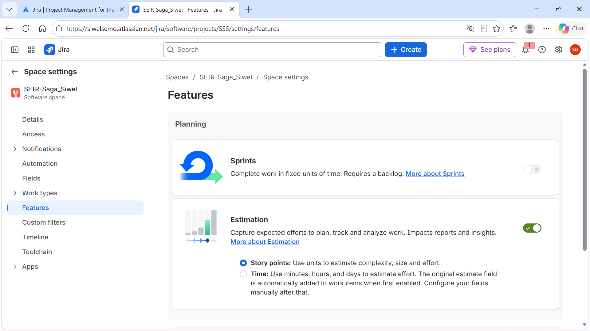
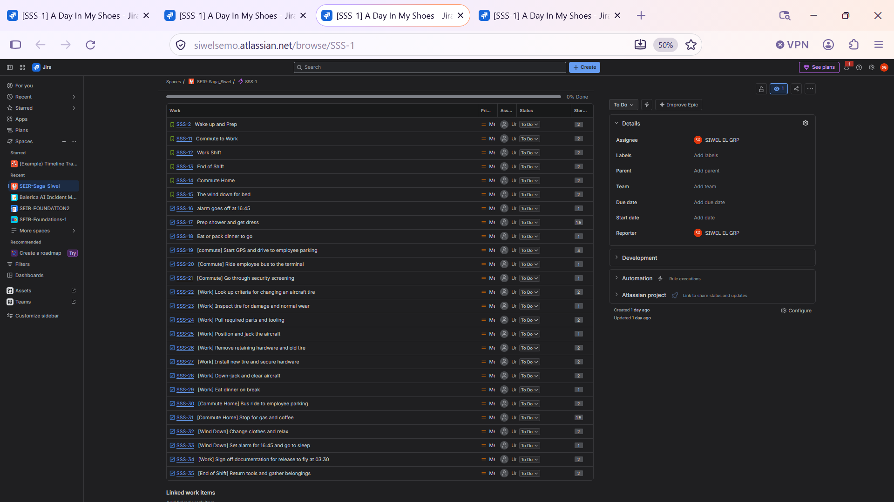
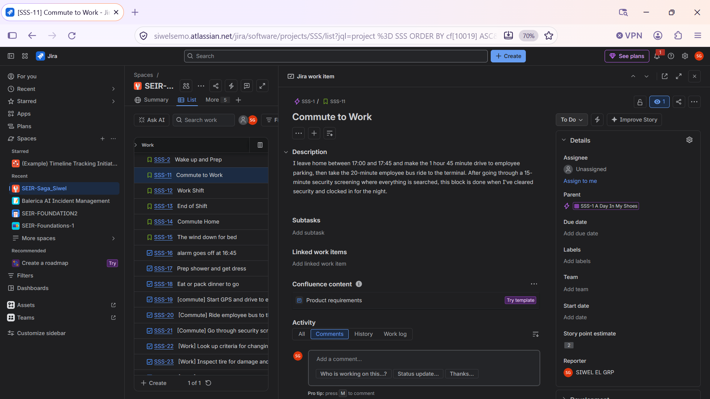
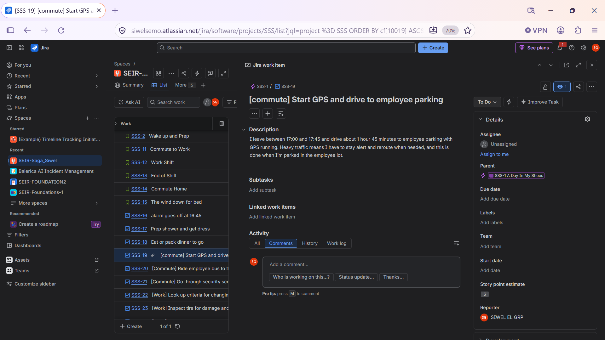
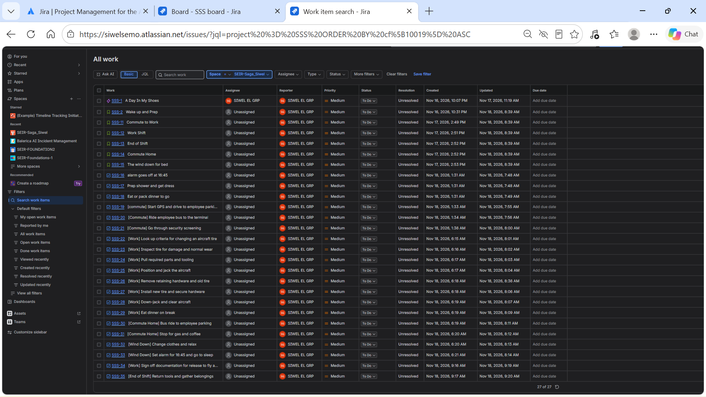

# Module 1, Lesson 3: A Day in My Shoes (Jira)

**Space name:** SEIR-Saga_Siwel
**Space key:** SSS

## Evidence table

| Key | Type | Summary | Story Points |
|-----|------|---------|--------------|
| SSS-1 | Epic | A Day In My Shoes | — |
| SSS-2 | Story | Wake up and Prep | 2 |
| SSS-11 | Story | Commute to Work | 2 |
| SSS-12 | Story | Work Shift | 2 |
| SSS-13 | Story | End of Shift | 2 |
| SSS-14 | Story | Commute Home | 2 |
| SSS-15 | Story | The wind down for bed | 2 |
| SSS-16 | Task | alarm goes off at 16:45 | 1 |
| SSS-17 | Task | Prep shower and get dress | 1.5 |
| SSS-18 | Task | Eat or pack dinner to go | 1 |
| SSS-19 | Task | [commute] Start GPS and drive to employee parking | 3 |
| SSS-20 | Task | [Commute] Ride employee bus to the terminal | 1 |
| SSS-21 | Task | [Commute] Go through security screening | 1 |
| SSS-22 | Task | [Work] Look up criteria for changing an aircraft tire | 2 |
| SSS-23 | Task | [Work] Inspect tire for damage and normal wear | 1 |
| SSS-24 | Task | [Work] Pull required parts and tooling | 2 |
| SSS-25 | Task | [Work] Position and jack the aircraft | 1 |
| SSS-26 | Task | [Work] Remove retaining hardware and old tire | 2 |
| SSS-27 | Task | [Work] Install new tire and secure hardware | 2 |
| SSS-28 | Task | [Work] Down-jack and clear aircraft | 2 |
| SSS-29 | Task | [Work] Eat dinner on break | 1 |
| SSS-30 | Task | [Commute Home] Bus ride to employee parking | 2 |
| SSS-31 | Task | [Commute Home] Stop for gas and coffee | 1.5 |
| SSS-32 | Task | [Wind Down] Change clothes and relax | 2 |
| SSS-33 | Task | [Wind Down] Set alarm for 16:45 and go to sleep | 1 |
| SSS-34 | Task | [Work] Sign off documentation for release to fly at 03:30 | 2 |
| SSS-35 | Task | [End of Shift] Return tools and gather belongings | 2 |

**Totals:** 6 stories, 20 tasks
**Total story points (stories + tasks):** 44

## My biggest task

My biggest task is **SSS-19, [commute] Start GPS and drive to employee parking**, at 3 points. I leave between 17:00 and 17:45 and drive about 1 hour 45 minutes in heavy traffic, so I have to stay alert, watch the GPS and reroute when needed. It takes far more time and focus than quick tasks like setting my alarm, so I gave it the highest estimate in my space.

## Screenshots

